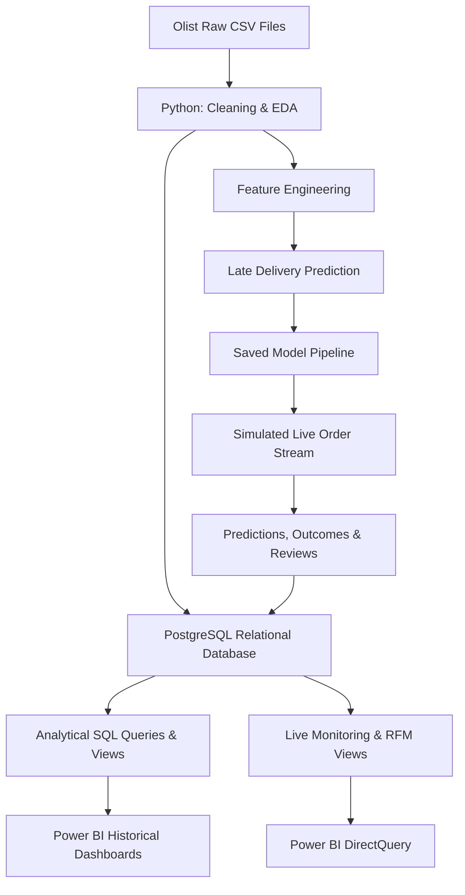

# E-Commerce Analytics & Late Delivery Prediction

An end-to-end data analytics and machine learning project using the **Brazilian E-Commerce Public Dataset by Olist**. This project combines Python, PostgreSQL, Power BI, and a simulated live-order pipeline to analyze business performance, understand delivery issues, and identify orders at risk of arriving late.

## Project Overview

E-commerce businesses need more than sales reports. They need to understand what drives revenue, where operational bottlenecks occur, and how customer experience affects retention.

This project builds an analytics workflow that transforms raw transactional data into actionable business insights, then extends it with a machine learning model and a simulated order-monitoring pipeline.

**Key objectives:**
- Analyze sales performance, product categories, and geographic distribution.
- Measure delivery reliability and its relationship with customer satisfaction.
- Identify customer purchasing patterns through RFM analysis.
- Predict potential late deliveries using machine learning.
- Build interactive Power BI dashboards connected to PostgreSQL.
- Simulate incoming orders, model predictions, delivery outcomes, and review updates.

## Pipeline Architecture

## Tech Stack

| Area | Technologies |
|---|---|
| Programming & analysis | Python, Pandas, NumPy |
| Visualization & EDA | Matplotlib, Seaborn |
| Machine learning | Scikit-learn, Logistic Regression, Decision Tree, Random Forest |
| Database | PostgreSQL, SQLAlchemy, pgAdmin |
| Data modeling & querying | SQL, joins, aggregations, window functions, views |
| Business intelligence | Power BI, DAX, DirectQuery, Import mode |
| Model persistence | Joblib |
| Development | VS Code, Jupyter Notebook, Git |

## 1. Data Cleaning & Preprocessing

**Tools:** Python, Pandas, NumPy

The project starts with nine raw CSV files covering the main entities of the Olist marketplace, including orders, customers, products, sellers, order items, payments, reviews, geolocation, and product-category translations.

The preprocessing workflow includes:

- Inspecting table structures, missing values, duplicates, and data consistency.
- Converting date columns to appropriate datetime types.
- Correcting data types, including preserving leading zeros in postal codes where necessary.
- Handling missing values according to their relevance to downstream analyses instead of indiscriminately dropping every incomplete row.
- Removing duplicate records and standardizing category labels using the English translation table.
- Preparing consistent datasets for analysis, modeling, and database loading.

The objective was to preserve useful information while ensuring reliable joins and accurate calculations.

## 2. Exploratory Data Analysis & Feature Engineering

**Tools:** Pandas, NumPy, Matplotlib, Seaborn

I explored the data to understand sales trends, customer behavior, geographic concentration, and delivery performance.

### Feature engineering

The analysis introduced business-oriented features such as:

- **Delivery delay:** Difference between actual and estimated delivery dates.
- **Late delivery flag:** Indicates whether an order arrived after its estimated date.
- **Order value:** Aggregated monetary value of order items.
- **RFM metrics:** Recency, Frequency, and Monetary value for customer segmentation.

A key data-modeling detail was distinguishing `customer_id`, which can differ across orders, from `customer_unique_id`, which identifies the same customer across purchases. RFM frequency therefore uses the unique customer identifier to avoid undercounting repeat purchases.

### Key business insights

The analysis highlighted several patterns:

- **Delivery and satisfaction:** Late orders received substantially lower average review scores than on-time orders.
- **Customer retention:** Approximately 97% of customers placed only one order in the analyzed dataset, indicating a potential repeat-purchase opportunity.
- **Geographic concentration:** São Paulo accounted for a large share of order volume.
- **Seasonality:** Sales activity increased over time, with a notable peak around November 2017.

These findings helped translate exploratory analysis into concrete business questions around logistics, customer experience, and retention.

## 3. Machine Learning: Late Delivery Prediction

**Tools:** Scikit-learn, Joblib

I formulated late delivery prediction as a binary classification problem.

**Business question:** Can an order be flagged as potentially late using information available when it is placed?

### Modeling workflow

1. Selected features available at order creation, such as customer state, product category, freight cost, order value, and order month.
2. Excluded information derived from actual delivery dates to avoid target leakage.
3. Split the data into training and testing sets.
4. Compared Logistic Regression, Decision Tree, and Random Forest models.
5. Accounted for class imbalance because late deliveries represented only a small fraction of orders.
6. Evaluated precision, recall, and other classification metrics rather than relying on accuracy alone.
7. Saved the trained preprocessing-and-model pipeline with Joblib for reuse by the simulated live-order process.

### Model evaluation

The Random Forest model offered a practical balance between identifying late orders and limiting false alarms in the experiments.

| Metric | Approximate result |
|---|---:|
| Late delivery rate in historical data | 7–9% |
| Recall for late deliveries | 60% |
| Precision for late deliveries | 15% |

These figures are approximate and should be replaced with the final evaluation results.

The recall indicates that the model identified around 60% of genuinely late orders in the evaluation set. The lower precision means many flagged orders were not actually late, so the model is best viewed as an early-warning prototype rather than a production-ready decision system.

## 4. PostgreSQL Database Design & SQL Analytics

**Tools:** PostgreSQL, SQLAlchemy, pgAdmin

I designed a normalized relational schema to organize the cleaned historical data and support analytical queries.

The core schema includes customers, sellers, products, orders, order items, payments, and reviews, with primary and foreign keys used to enforce referential integrity.

### Data loading and integrity

Cleaned datasets were loaded from Python into PostgreSQL. During this process, I encountered and resolved practical data-quality issues, including:

- Foreign-key violations caused by child records referencing missing parent records.
- Duplicate review identifiers that violated primary-key constraints.
- Inconsistent keys that required validation and filtering before insertion.

These issues reinforced the importance of validating relationships before loading data into a relational database.

### SQL analysis

The analytical layer includes:

- Joins across multiple tables.
- Aggregations using `GROUP BY`.
- Conditional metrics using `CASE WHEN`.
- Ranking and running totals with window functions such as `RANK()` and `SUM() OVER()`.
- Monthly revenue and operational performance analysis.
- Customer segmentation and category performance queries.

### Analytical views

Reusable SQL views provide a consistent interface for the BI layer, including:

- `vw_monthly_kpis` — monthly business performance.
- `vw_category_performance` — product-category metrics.
- `vw_customer_segments` — customer purchasing segments.

Additional views combine historical and simulated data for order lifecycle reporting, model monitoring, and live customer segmentation.

## 5. Power BI Dashboard

**Tools:** Power BI Desktop, DAX, PostgreSQL

Power BI connects directly to PostgreSQL to present the analytical results through a three-page interactive dashboard.

### Executive Overview

Provides a high-level view of business performance through KPIs and visualizations such as:

- Total revenue and order volume.
- Average order value.
- Monthly revenue trends.
- Top-performing product categories.

### Operations

Focuses on delivery reliability and customer experience:

- Late delivery rate.
- Delivery delay distribution.
- Comparison of review scores for late and on-time orders.
- Operational trends that may require investigation.

### Customers

Focuses on purchasing behavior and retention:

- RFM-based customer segmentation.
- One-time buyer rate.
- Repeat purchasing patterns.
- Customer value and purchasing distribution.

### Data modeling and DAX

The Power BI model follows a relational, star-schema-like structure with relationships aligned to the underlying database keys.

DAX measures use functions such as `CALCULATE()`, `DIVIDE()`, and `DISTINCTCOUNT()` to compute business KPIs while handling filter context and safe division.

For the historical dataset, I used **Import mode** for responsive reporting. The simulated live data uses **DirectQuery** so new records can be reflected without re-importing the entire historical dataset.

## 6. Simulated Live-Order Pipeline & Model Monitoring

To go beyond static analysis, I built a Python script that simulates a stream of incoming orders and connects model predictions with their eventual outcomes.

This is a local simulation, not a connection to Olist's actual live transactions.

### Simulated order lifecycle

1. **Order created:** A new simulated order enters the pipeline.
2. **Risk prediction:** The saved model estimates the probability of late delivery.
3. **Prediction stored:** The prediction is written to the `order_risk_predictions` table.
4. **Outcome resolved:** After a simulated delay, an outcome is generated and stored in `new_order_outcomes`.
5. **Review generated:** A review is generated later in `new_order_reviews`, with scores sampled according to the simulated delivery outcome.

The simulation incorporates existing and new customers so that customer metrics can evolve as additional orders enter the system.

### Unified SQL views

The historical and simulated records are exposed through views that support consistent reporting:

- `vw_all_orders` — combines historical and simulated order records with a lifecycle status such as `in_transit`, `delivered`, or `reviewed`.
- `vw_model_monitoring` — compares model predictions with eventual outcomes to calculate monitoring metrics.
- `vw_live_rfm` — recalculates RFM metrics using historical and simulated purchases.
- `vw_live_customer_segments` — refreshes customer segments as purchasing activity changes.

Fields that are not yet known remain `NULL` until their simulated lifecycle stage occurs, rather than being filled with invented outcomes prematurely.

### Power BI integration

The live-oriented views are connected through DirectQuery, with page refresh configured to poll for updates at a short interval.

This demonstrates how predictions, eventual outcomes, customer behavior, and monitoring metrics can be connected in one reporting workflow. The actual refresh interval and responsiveness depend on the Power BI configuration and local database performance.

### Monitoring concept

The monitoring view provides a foundation for comparing predicted risks with observed outcomes over time. A production implementation could extend this with threshold-based alerts, scheduled model evaluation, and retraining when performance degrades.

## Challenges & Lessons Learned

- **Data integrity:** Resolving duplicate identifiers and foreign-key violations during relational database loading.
- **Class imbalance:** Evaluating recall and precision instead of optimizing accuracy alone.
- **Data leakage:** Restricting prediction features to information available at order creation.
- **Customer identification:** Using the correct customer identifier for repeat-purchase and RFM calculations.
- **Historical versus live data:** Combining static historical records with simulated events while keeping incomplete lifecycle information explicit.
- **BI performance:** Using Import mode for historical analysis and DirectQuery for the changing simulated data.

## Limitations & Future Improvements

The project is a portfolio prototype rather than a production deployment.

Potential improvements include:

- Connecting to a genuine order API or event-streaming platform instead of simulated data.
- Improving late-delivery precision through additional features, hyperparameter tuning, and threshold optimization.
- Adding automated tests, data validation, logging, and failure recovery.
- Introducing alerts when model performance falls below a defined threshold.
- Deploying the database and raw data to AWS, using services such as Amazon RDS for PostgreSQL and Amazon S3.
- Improving scalability and refresh efficiency as data volume grows.

## Getting Started

### Prerequisites

- Python
- PostgreSQL and pgAdmin
- Power BI Desktop
- The Olist dataset, subject to its applicable terms
- Python packages used by the notebooks and scripts

### Setup

1. Clone the repository.
2. Create and activate a Python virtual environment.
3. Install the project's dependencies.
4. Configure the PostgreSQL connection and create the required database.
5. Run the data-cleaning and feature-engineering notebooks or scripts.
6. Create the schema and analytical views using the SQL files.
7. Train the model or load the saved model pipeline.
8. Configure and run the simulated live-order script.
9. Open the Power BI report and update its database connection settings.

Exact commands depend on the filenames, database configuration, and dependencies in the current repository.

## What This Project Demonstrates

- End-to-end data analysis from raw files to business reporting.
- Practical data cleaning, exploratory analysis, and feature engineering.
- SQL database design, data integrity, and analytical querying.
- Classification under class imbalance and awareness of data leakage.
- Interactive dashboards and DAX-based business metrics.
- A simulated prediction lifecycle with outcome tracking and model monitoring.

## Dataset & Acknowledgments

This project uses the **Brazilian E-Commerce Public Dataset by Olist**, containing anonymized historical e-commerce records.

The dataset is used for learning and analytical demonstration. All findings are specific to the available historical data and should not automatically be generalized to other e-commerce businesses.

See the `LICENSE` file for the licensing terms applicable to this project. Third-party datasets, libraries, and assets remain subject to their respective licenses and terms.
